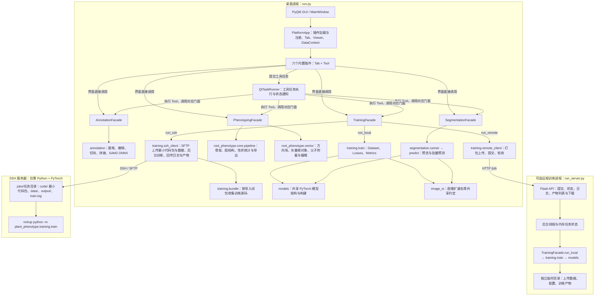

# FenoSuite 当前架构

根据当前源码核对：桌面端为 PyQt6 单体应用；远程训练有两种方式——SSH（推荐，服务器无需部署项目）和可选的 Flask 训练服务，二者都只运行训练任务。

## 核对说明

- `gui/main_window.py` 创建 `PlatformApp`、`QtTaskRunner`，加载六个内置插件（含数据集和根系表型beta）。插件贡献 Tab 和 Tool；界面交互可以直接调用门面，长任务通过任务运行器执行 Tool。
- 四个门面是各业务包的入口，算法实现仍分别位于 `annotation/`、`training/`、`segmentation/`、`root_phenotype/`。
- `DataContext` 是桌面会话内存状态，保存最近权重、掩码路径及表型结果，归属 `app/`。
- `models/` 保存模型架构代码，训练和分割显式依赖它；标注的 SAM2/ONNX 推理位于 `annotation/inference/`。
- `training/remote_client.py` 负责提交、轮询。当前 `run_remote_training()` 完成后返回任务 ID；产物下载接口由服务端提供，客户端未自动下载产物。
- `training/ssh_client.py` 使用 paramiko 连接服务器：检查远端 PyTorch 与依赖（可自动 pip 安装缺失项），上传 `training/bundle.py` 生成的最小代码包（训练入口的导入闭包，约 30 个文件）、数据 zip 与配置，以 `nohup setsid` 后台启动训练（断线不影响训练），轮询 `train.log` 推送日志，结束后把 `output/` 下载到本地保存目录。取消时按进程组终止远端训练。
- `server/app.py` 仅调用训练门面的 `run_local()`；服务端使用后台线程、内存任务字典和独立临时任务目录。
- `workspace/` 是默认本地数据与输出目录，实际路径也可由配置或界面指定。它不是数据库；远程服务也不直接共享桌面端文件目录。
- 数据集：`datasets/` 是不依赖 Qt 的数据层，`workspace/datasets/<ID>/` 下用 `dataset.json`、`samples.json` 记录类别和样本对应关系。`PlatformApp.datasets`（`DatasetService`）保存当前数据集并通知各页面；第五个内置插件 `app/plugins/datasets/` 提供「数据集」页和 `datasets.*` 后台工具。标注、根系表型页通过 `gui/dataset_panel.py` 选择样本，训练经 `datasets/training_source.py` 读取配对，分割结果经 `datasets.import_predictions` 入库。详见 [datasets.md](datasets.md)。

## 图像说明

独立的「根系表型beta」页由 `app/plugins/root_phenotype_beta/` 注册，使用 `root.vector.analyze`、`root.vector.resolve` 工具及 `gui/root_vector_canvas.py` 矢量画布；`RootDocument` 是结果与编辑的权威数据，单独保存在 DataContext 的 `root_phenotype.vector_document` 键中。后台工具返回结果，由控制器在 UI 线程核验请求版本和来源后提交。设计见 [方向场辅助的矢量根系解析架构](ROOT_VECTOR_ARCHITECTURE.md)，操作见 [beta 使用说明](root-beta.md)。原有骨架图分析流程独立保留。

`FenoSuite架构图.png` 是当前架构概览，使用内置 imagegen 生成。上方 Mermaid 保留了界面直接调用、任务调度以及远程客户端行为的细节，可作为后续修改的可编辑源。

绘图规格：白底、绿/蓝/紫分区；桌面 GUI → 插件平台 → 四个业务门面及算法；训练/分割依赖共享 models；远程训练客户端通过 HTTP 连接独立 Flask 训练服务；DataContext 归属桌面平台；文件目录与模型代码分开表示。
