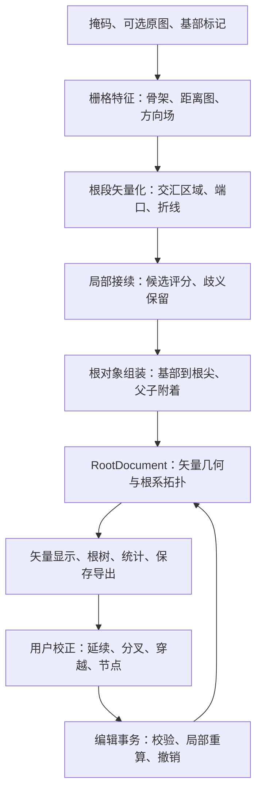

# 方向场辅助的矢量根系解析：详细架构

状态：本设计的主流程已实现为独立的「根系表型beta」标签页，实际操作见 [beta 使用说明](root-beta.md)。算法位于 `root_phenotype/vector/`；插件与控制器位于 `app/plugins/root_phenotype_beta/`，矢量画布为 `gui/root_vector_canvas.py`。下文保留原始详细设计与扩展边界；原有根系表型页独立保留。设计依据为现有项目以及 `F:/Tools/vector_field/` 源码。

## 当前实现更新：任意根内选点

交互入口已改为范围选点：`selection_points` 只选择根系，不指定基部。当前流程是「选中连通域 → 相向断口连接 → 小孔填补与骨架短毛刺清理 → 矢量化 → 完整主根推断 → 侧根及级次组装」。范围选择和形态推断实现于 `vector/selection.py`。

分析时临时建立根段与交汇的邻接图，从端点间路径中综合长度、直径和局部方向代价选择主根。树状根系通过子树动态规划比较所有真实端点路径，不再抽样端点；有环图保留有界候选搜索并提示复核。先固定主根经过的交汇接续，再从主根向外确定侧根延续及附着。文档仍保存矢量根、父子关系和可复核的交汇决定，不把栅格图作为最终数据模型。基部由两端附近粗细自动推断，粗细相近时按图像上方、再左方定向。单幅形态不保证发育学身份。

版本 `vector-beta-5-proximal-anchor` 增加成对粗端约束：将端点邻域中位直径降序排列，若第二粗端至少为第三粗端的 1.5 倍，且前两端的直径比不超过 1.25，则优先连接这两个突出且相近的粗端。否则保持无端点约束的搜索，避免将单个膨大交汇或断口误当基部。该依据独立于用户选点。

组装与重新接续后，`vector/quality.py` 检查最终主根折线的直径序列：使用首尾各 5% 有效节点（至少 3 个）的中位直径，两端比值不超过 1.25 时取较小值为参照。两段粗根之间存在直径低于参照 60%、实测长度至少为参照 3 倍的细段，则标记 `possible_trunk_detour`。缺测区间不累计细段长度；连续缺测超过一个参照直径时中断判断。主根及依赖该主根的侧根归属进入 `pending`，画布与 SVG 用虚线表示，表格导出 `quality_flags`。明确的人工确认不被覆盖；该提示是形态异常检测，并不恢复缺失几何。`combo_012` 回归验证端点身份与待确认状态，不宣称中间缺失主干或所有父子关系正确。

主根路径采用「各段长度×中位直径四次方之和 − 局部交汇惩罚」评分，以较强的直径权重避免长细侧根胜出；四次方是经合成案例检验的启发式排序权重，不代表测量体积或生理参数。每处惩罚只作用于相邻段的方向采样窗口，且不超过各段一半长度，避免密集分叉对共享长主干重复扣分。取消局部配对冲突数的绝对优先级，防止局部较直的短侧枝否决完整弯曲轴。有环图使用长度/直径平方作为候选路径的行进代价，避免单纯的几何最短路走入细根捷径；侧根附着的距离仍使用实际弧长。这部分自 `vector-beta-4-complete-axis` 引入，当前版本继续沿用。回归覆盖末端密集细侧枝、共同主干长度变化、旋转、任意根内选点、多端点根系、弯曲主根旁的直侧根和细根闭环捷径。复杂闭环及严重缺失仍不保证正确恢复。

断根连接上限默认 20 px，衡量真实背景断口长度，计入粗根骨架端点向内部回缩的影响。只从选中连通域逐轮向邻接碎片扩展，不分析其他独立根；两端必须相向、粗细相容，桥线不得穿越第三个连通域。去毛刺默认 5 px，两项参数均可设为 0 关闭。补接段的直径标为缺失。已粘连植株、真实交叉和闭环仍需人工核对。

JSON 新增可选 `selection_points` 字段并保留自动推断的 `base_marks`，旧文档仍可加载。界面固定使用主根红色、一级侧根蓝色、更高级侧根紫色、待定灰色；编号与级次在右侧根树中显示，画布不显示这些文字。后台任务、交汇校正、撤销和导出沿用现有文档事务机制。

下文为首版设计记录：其中“必须手工点选基部”“不做自动断根连接”和“仅局部接续判定主根”等约束，已由上面的当前实现替代。亚像素边界精修、三维恢复和遮挡恢复仍不在当前范围内。

## 1. 功能目标与核心决定

用户为每条需要分析的主轴指定基部，系统把分割掩码转为一组带直径的矢量根对象；在交汇处利用方向、粗细连续性判断根的延续，在确认分叉后建立父子关系，输出主根、一级侧根、二级侧根等性状。用户可以在图上改正接续关系，统计随之更新。

整个方案围绕两个不同的问题组织：

1. **根的身份：哪些根段属于同一条根？** 通过局部接续得到完整的矢量折线。
2. **根的谱系：一条根从哪条根长出？** 通过基部方向和分叉附着关系建立父子树。

最终数据主体是“矢量根对象 + 父子关系”。骨架、距离图、方向场是分析时使用的辅助数据。内部仍保留根段和交汇端口的邻接表，但主侧根判定不再依赖通用加权图的全局最长路径。

第一版采用二维、半自动流程，使用现有 NumPy、OpenCV、scikit-image 等依赖。方向场采用确定性的结构张量计算，不引入附件中的 CNN 或颜色扩散。浮点矢量坐标不等于已经具备亚像素测量精度；第一版的直径来自距离变换，灰度边界精修留作后续独立增强。

对于多条基生根，可以指定多个主轴。界面的“主根”表示本次分析中指定的起始轴，单幅二维图像不能自动证明其发育学起源，也不能恢复三维拓扑。

## 2. 总体结构



| 层 | 职责 | 不负责的事项 |
| --- | --- | --- |
| 栅格特征 | 生成骨架、距离图、局部轴向及可信度 | 不赋予主侧根身份 |
| 根段矢量化 | 把像素链压缩为根段，保留交汇端口 | 不把几何相交直接解释为亲缘关系 |
| 接续与谱系 | 连接同根片段，按已确定基部建立父子关系 | 不在证据不足时强制选出一条主根 |
| 文档与统计 | 保存根对象、编辑结果、测量值与质量标记 | 不依赖 NetworkX 图作为权威数据 |
| 应用与交互 | 后台任务、显示、选择、校正、导出 | 不在 Qt 事件处理中实现识别算法 |

## 3. 权威数据模型

### 3.1 坐标、单位与根级次

- 统一使用图像坐标 `(x, y) = (col, row)`，左上角像素中心为 `(0, 0)`，x 向右、y 向下。NumPy 数组始终按 `[row, col]` 访问，旧界面种子坐标仅在入口转换一次。
- 几何和直径以像素保存；标定单独保存为正数 `mm_per_pixel`。第一版仅支持等比例标定；未标定时明确输出 px，不填伪造的 mm 值。
- `order=0` 表示已指定基部的主轴；子根为 `parent.order + 1`。未定归属的根 `order=null`，不会因为 `parent=null` 就自动成为主根。
- 根的节点顺序在方向已知时统一为基部到根尖。无向方向场本身不提供这个生物学方向。

### 3.2 对象定义

| 对象 | 主要字段 | 用途 |
| --- | --- | --- |
| `RootDocument` | `schema_version, document_id, revision, source, config, base_marks, roots, junction_decisions, analysis_snapshot` | 可保存、可编辑的唯一权威结果 |
| `SourceRef` | 图像/掩码路径、尺寸、内容哈希、标定、算法版本 | 防止旧分析与新图像混用；支持追溯 |
| `RootNode` | `id, x, y, diameter_px, diameter_source, tags` | 紧凑折线节点；直径可为 null，来源为 measured/interpolated/manual/missing |
| `VectorRoot` | `id, nodes, parent_attachment, base_mark_id, direction, review_state, completeness, source_segment_ids, quality_flags` | 一条根的身份、几何、谱系和质量；级次从父链派生 |
| `ParentAttachment` | `parent_root_id, parent_node_id` | 子根在父根上的稳定附着位置 |
| `BaseMark` | `id, x, y, root_id, direction_hint, specimen_id` | 用户指定的基部及可选植株分组；不是旧流程的连通域选择点 |
| `JunctionDecision` | `id, port_ids, alternatives, chosen, state, source, score_terms` | 分叉/穿越/接续的候选与选择依据；state 为 pending/accepted/stale |
| `AnalysisSnapshot` | `analysis_id, segments, junctions, parameter_hash` | 矢量化中间结果，用于重新选择接续；不保存整幅方向数组 |

`review_state` 区分 `auto / confirmed / pending`；`completeness` 区分已到可见根尖、在待定交汇处停止、在图像边界截断等情况。这两项不能合并：自动识别的根可以完整，人工确认的根也可能被图像边界截断。

根的长度、平均直径、级次、父根上的弧长位置是派生数据，由当前文档重新计算，不与节点坐标维护两套可写值。导出时可以生成相应列。

### 3.3 附着方式

子根附着时，在父根折线上插入一个带稳定 ID 的节点，`ParentAttachment` 引用该节点。该节点和子根首节点坐标保持一致，但它们属于各自的根，直径可以不同。

例如：

```text
R1 主根：N1 ─ N2 ─ N3 ─ N4       order = 0
                  │
                  └── R2          parent = R1:N3, order = 1
                        └── R3    parent = R2:M2, order = 2
```

附着节点不能被折线简化删除。父根局部编辑后，附着位置的弧长重新计算；移动附着节点时同步移动子根首节点，并使相关角度和直径测量失效，等待重算或标为缺失。不会默默平移整条子根。

X 型穿越只记录两条路径之间的几何事件，不创建 `ParentAttachment`。两条根可以经过同一二维坐标，而没有父子关系。

### 3.4 必须保持的不变量

1. 每条根最多一个父根，父链无环，所有引用指向存在的根和节点。
2. 已附着子根的首节点与父附着节点重合；父根方向和子根方向都必须满足附着语义。
3. 交汇区外的一条原始根段只能归属于一条已组装根；尚未确定的片段保留在中间结果中。交汇内部允许不同根的二维路径重叠。
4. 已知级次必须能追溯到一个有效基部标记；两个基部争用同一根段时形成冲突，不按处理顺序决定胜负。
5. 节点数至少为 2，坐标有限、相邻重复点被合并；有效直径必须为有限正数，缺失直径使用 null，不能用 0 代替。
6. 手工确认决定不被后台重算覆盖。来源图像、参数或相关几何变化后，无法复用的决定标为 stale。

## 4. 算法流程

### 4.1 准备掩码与骨架

输入是现有分割模块产出的二维掩码，可选原始灰度图。第一版以掩码作为可重复的方向计算输入；原图用于显示和后续边界精修。

生成二值掩码、距离变换 `D = 2 * distance_transform(mask)` 和单像素骨架。处理指定的图像区域，保留全部候选连通域，不默认只留下最大连通域。

新模式默认关闭自动跨断口连接和短枝删除，形态学处理采用显式参数。小面积噪点可标记或按配置过滤，但记录被过滤对象；真实细侧根不能只因短或细就从源数据消失。掩码发生变动时生成新的内容哈希。

### 4.2 计算方向场

对归一化掩码计算 Sobel 梯度及窗口平均结构张量：

```text
Jxx = mean(gx²), Jxy = mean(gx·gy), Jyy = mean(gy²)
theta_normal = 0.5 * atan2(2·Jxy, Jxx - Jyy)
theta_tangent = theta_normal + π/2
coherence = sqrt((Jxx-Jyy)² + 4·Jxy²) / (Jxx+Jyy+epsilon)
```

附件使用的角度公式给出梯度主方向；这里必须旋转 90° 才用于根切向判断。内部保存 `(cos(2θ), sin(2θ))`，以避免 θ 与 θ+π 的等价性导致平均方向错误。

实施规则：

- 窗口尺寸随局部根宽选择，必须覆盖到边缘；先实现少数离散尺度，逐尺度计算后保留适用结果，避免同时保存多套大图。
- 同时检查张量能量 `Jxx+Jyy` 和 coherence。粗根内部没有梯度时，即使公式返回 0°，也标为无效方向。
- 交汇中心方向容易混杂。方向和直径特征取自交汇外围的一段根，采样长度按局部直径确定，不能只取相邻一个像素。
- 方向场不可用时，使用外围骨架短链拟合切线；两者明显矛盾时降低决策质量，不强行以颜色或单个箭头覆盖几何证据。

方向场着色只作为调试层。根的显示颜色由 `root_id` 决定，同一根弯曲后仍然保持同色。

### 4.3 骨架压缩为根段与端口

先使用统一的像素邻接规则识别端点和交汇候选。需处理 8 邻域中的冗余对角连接，避免把阶梯折线识别为密集分叉；该规则在检测与追踪中必须一致，并通过旋转后的合成图验证。

把相邻交汇像素聚合为一个 `JunctionRegion`，在离开区域的每条独立骨架链上建立一个 `Port`。两个相近但独立的分叉之间如果还有可辨识根段，不能只按固定半径合并。

```text
Segment：id、端口/端点、折线、直径采样、质量信息
Port：id、segment_id、junction_id、位置、向外切线、外围直径、方向质量
JunctionRegion：id、区域范围、ports、局部连接候选
```

从端点或端口沿度为 2 的骨架链追踪，使用“无向骨架边已访问集合”避免重复。纯环没有端点，必须额外扫描未访问边并保存为待处理闭环；孤立点单独记录，不能悄悄丢弃或无限循环。

第一轮只做轻度简化，保留端口附近的密集采样供评分。完整根组装后再压缩为最终折线，同时限制：位置偏差、直径插值误差、弧长变化。端点、附着点、人工固定点和交汇锚点全部强制保留。

### 4.4 交汇处的接续评分

所有端口切线都定义为“从交汇区域指向外部”。因此两段直线延续时，两个端口切线应近似反向。不可直接用无向夹角的绝对值来替代这个接续判断。

对候选端口对 `(i, j)` 计算：

```text
turn(i,j) = acos(clamp(-u_i · u_j, -1, 1))
e_direction = turn / π
e_diameter = min(1, abs(log(d_i / d_j)) / log(2))
e_field = 1 - abs(f_i · f_j)   # f 为外围有效的无向切向单位向量
cost = 按有效证据加权的上述误差，越小越好
```

初始权重建议为方向 0.60、直径 0.25、方向场 0.15，仅作为实现起点。方向场与骨架方向相关，不能把它们当成两个独立概率相乘。缺失直径或方向场时对应权重归零并重新归一化，同时记录证据覆盖度；覆盖不足时不自动接受。

判断同时要求最佳候选成本足够低、与次佳候选差距足够大。只有一个候选也需要绝对质量检查。成本阈值、差距阈值和采样尺度用标注样本校准，不把初始参数称为已验证准确率。

对于四端口区域，比较完整的互斥配对方案，而不是让每个入口各自贪心选出口。一个端口在同一接续方案中最多匹配一次。高阶或拥挤交汇先保留候选，限制组合数，不做指数级全图搜索。

**直径只提供连续性线索。不能采用“最粗的一支永远是主根”或“最长的一支永远是主根”的规则。**

### 4.5 从接续关系组装根与父子关系

处理顺序是基部定位 → 沿当前根延续 → 处理明确侧支 → 递归处理侧支自身分叉。

1. 将用户基部标记吸附到附近的骨架端点或指定根段，检查距离和唯一性。如果点击在根中段，先显示双向候选，要求选定朝根尖的一侧或补充基部位置，不能仅凭粗细自动定向。
2. 从基部向根尖行进；普通根段直接并入当前根。
3. 到三端口区域时，根据进入方向选择延续候选。仅当当前根身份和方向已知、接续证据充分且接受分叉解释时，剩余侧支建立为子根。
4. 子根首点附着在父根的稳定节点上，再以该点为其基部递归追踪，因此自然产生更高阶侧根。
5. 到四端口区域时，先考虑两条根分别穿越的接续方案。它可以给出几何连续路径，但不自动证明穿越类别，更不能直接给另一条根设置父根。
6. 遇到接续分数接近、两个主轴争用、闭环或接触粘连，保留该处决定为 pending，停止依赖它的谱系传播。已有确定部分仍可显示和测量。

交汇内部的短连接折线须位于合理的掩码区域，并衔接端口方向，不强迫所有路径经过同一个质心。该处的根宽通常被其他根污染：默认记为缺失，或显式使用两侧插值并标记 interpolated，不作为直接实测值。

| 几何情况 | 可以自动做的事 | 需要保留的边界 |
| --- | --- | --- |
| 清晰 Y 型，有已知基部且一个延续明显更好 | 延续同一根，将余支作为自动推断子根 | 保存 auto 来源，用户可改；近似对称 Y 要待确认 |
| 清晰 X 型，两组延续明显 | 提出两条独立路径，不建立父子关系 | 二维图像仍可能是接触或两个邻近分叉，类别可待确认 |
| T 型、断根末端触碰另一根 | 提出分叉/接触两种解释 | 单靠三端口和方向不能可靠决定亲缘 |
| 重叠成一条长带或密集团块 | 保留可见外围根段和未解析区域 | 单幅掩码缺失的信息不能靠强制接续补出来 |
| 无基部标记 | 提取并显示候选根段与接续 | 主侧根归属保持未定；批处理需要基部输入或后续确认 |

无需一次性解决所有交汇。局部决定接受后，只重组受影响的根及其后代；尚未确认的区域不会把错误父子关系传到整株植物。

## 5. 矢量性状统计

统计输入只有当前 `RootDocument`，不继续从旧图的边级标签统计。

对节点 `p_i=(x_i,y_i)` 和有效直径 `d_i`：

```text
l_i = norm(p_(i+1) - p_i)
root_length_px = sum(l_i)
mean_diameter_px = sum(l_i * (d_i+d_(i+1))/2) / sum(l_i)
```

平均直径公式仅对两端直径均有效且质量符合选项的区间求和；同时输出 `diameter_coverage`。默认排除插值和缺失区间；允许单独导出“包含插值”的估计列。完全没有有效区间时为 null。

| 指标 | 定义 |
| --- | --- |
| 根数 | 按具有确定身份/级次的根对象 ID 计数，不用全部末端数量替代侧根数 |
| 总长度与平均长度 | 按级次汇总同一筛选集合；区分完整根与截断/待续根 |
| 附着位置 | 父根基部至附着节点的当前弧长，可另给占父根可见长度比例 |
| 分枝角 | 父根沿基部到根尖的局部切线，与子根从附着点向外的切线夹角，0–180° |
| 无向夹角 | 如需兼容旧显示，单独命名为 `acute_angle_deg`，取 0–90°，不能和分枝角混用 |
| 根尖位置 | 根对象的可见末端；待定交汇停止点不标为真实根尖 |
| 侧根密度 | 指定父根上的直接子根数 / 该父根有效长度；注明级次、完整性和单位 |

角度使用有限弧长窗口拟合，避开交汇混合区；没有有效方向时为 null，不能填 0°。图像边界截断根的长度是可见长度，待定接续根的长度是已解析长度，二者不冒充完整生物学长度。

汇总同时给出纳入根数、自动/人工确认数、未定片段数、未定交汇数及截断根数。短根过滤只影响选定统计视图，不删除源根对象。原始测量值始终保留；若以后做标准化，另增列，不覆盖长度、直径原值。

## 6. 交互设计

通过独立的「根系表型beta」标签页提供选图、缩放、平移、矢量解析和导出流程。

标准操作为：**选择掩码 → 点基部 → 查看同色根与父子树 → 处理标出的疑点 → 保存/导出**。多个植株可逐个点基部；没有基部的候选保持灰色。

画布分层显示：原图/掩码底图、按 root_id 着色的根折线、可选直径带、基部与附着点、待确认交汇。方向场和骨架放入调试显示选项，不占据普通操作流程。

根的选取按鼠标到折线的屏幕距离完成，容差随缩放换算，不能通过读取颜色来反推根 ID。交叉处命中多条根时显示候选或允许循环选择。

单击一条根时，画布和根树同步选中该 ID，右侧显示级次、父根、长度、直径、质量。点击待定交汇时，仅展示与本次判断有关的局部选项：

- “这两段是同一条根”：选择延续端口对。
- “这里是分叉”：确认父根延续与子根。
- “这里是穿越”：确认两组路径且无亲缘连接。
- “暂不确定”：保留现状。

同一位置支持撤销重做。后续可编辑节点、改变附着父根、删除误识别根；带子根的删除默认保留子根为待归属对象，明确选择删除整棵子树时才连同删除。已附着子根反向涉及基部变化，必须通过重新附着事务，不能只把坐标数组倒序。

## 7. 模块划分与现有代码接入

以下是拟新增文件，不表示当前仓库已有这些实现：

```text
plant_phenotype/root_phenotype/vector/
    models.py       # 文档、根/节点、端口、决定、配置及不变量校验
    features.py     # 预处理编排、距离图、骨架、方向场
    vectorize.py    # 交汇区域、端口、根段追踪、受约束折线简化
    resolve.py      # 接续候选评分、局部匹配、根组装、父子关系
    metrics.py      # 根级、父子级、植株级测量，不依赖 Qt
    editing.py      # 编辑命令、变更集合、局部重算和校验
    io.py           # JSON 保存载入、表格和矢量导出
    pipeline.py     # 阶段编排、取消与进度回调、缓存边界

plant_phenotype/app/plugins/root_phenotype/
    vector_controller.py  # 页面会话、任务版本、编辑历史、提交结果

plant_phenotype/gui/
    root_vector_layer.py  # 矢量绘制与命中测试，复用现有画布变换
```

纯算法层使用普通数据类和数组，不导入 Qt、DataContext 或任务平台对象。Pandas 表格转换可在门面/导出边界完成。

| 现有位置 | 接入方式 |
| --- | --- |
| `root_phenotype/facade.py` | 新增显式矢量入口，保留现有 analyze/correct_main_root；对 GUI 再导出所需文档类型 |
| `root_phenotype/core/preprocess.py`、`skeleton.py` | 复用明确适用的底层函数，新流程独立配置，避免继承自动连接/剪枝副作用 |
| `core/topology.py` | 参考骨架链追踪，但新增交汇区域、端口及闭环处理，不直接把现有关键点当最终分叉 |
| `core/graph.py`、`main_root.py`、`tree.py` | 留给旧模式；新模式不调用全局主路径和边级次分配 |
| `core/stats.py` | 保留旧语义；新指标另实现，避免把 root_id 与图边混为一谈 |
| `app/plugins/root_phenotype/tools.py`、`plugin.py` | 注册 `root.vector.analyze` 和 `root.vector.resolve` 后台工具 |
| `app/plugins/root_phenotype/tab.py` | 调用新控制器；保留旧模式路径，避免在现有大文件中继续堆算法状态 |
| `gui/root_canvas.py` | 复用坐标变换、缩放、平移，委托矢量层绘制和选取 |
| `gui/root_phenotype_stats_panel.py` | 增加矢量文档适配入口，明确统计口径与单位 |
| `app/data_context.py` | 新键 `root_phenotype.vector_document`；不覆盖旧 pipeline_result |

### 门面接口草案

```python
analyze_vectors(request, *, progress=None, check_cancel=None) -> VectorAnalysisResult
resolve_vectors(document_snapshot, decisions, *, check_cancel=None) -> EditResult
apply_vector_edit(document_snapshot, command) -> EditResult
measure_vectors(document, selection=None) -> MeasurementTables
save_vector_document(document, path) -> None
load_vector_document(path) -> RootDocument
```

`VectorAnalysisResult` 包含 document、诊断信息、可选显示缓存；`EditResult` 包含新文档、受影响根 ID 和编辑前后差异。所有输入快照只读，不在原对象上修改 GUI 正在显示的数据。

`request` 明确区分 mask、image、base_marks、config 和标定。路径输入与数组输入使用相同预处理规则，不能以输入类型暗中决定是否执行清理。大数组仅在进程内传递；文件和 JSON 协议使用路径及元数据。

配置使用独立的 `VectorAnalysisConfig`，保存实际生效的预处理、方向尺度、接续门槛、简化误差及质量筛选参数；不沿用旧全局最长路径的权重字段。普通页面只暴露基部、校正和必要的精度选项，算法权重放入高级配置。

计算成功但存在歧义时，后台任务仍返回 success，文档的派生状态为 `needs_review`；空掩码返回带说明的空文档。文件读取失败、尺寸不匹配或输入非法才返回 failed。取消返回 cancelled。这样不会把“需要人工确认”混同为程序报错。

## 8. 后台任务、局部更新与撤销

复用当前 `QtTaskRunner`。新工具计算完成后只返回 Artifact，不在工作线程中修改 DataContext。由页面控制器在 UI 线程检查结果身份后提交。

每次任务携带 `(document_id, base_revision, source_hash, parameter_hash, request_id)`。首次分析先由控制器分配文档 ID 和初始修订号。只有当前文档 ID、修订号、输入来源、参数和最新请求均匹配才应用结果；新的 `analysis_id` 随分析快照记录。切换图像、切模式、编辑或再次分析会使旧任务结果过期；过期结果可以留在任务记录中，但不能覆盖当前文档。

新控制器取消旧任务后直接提交新请求，不在 UI 线程调用 `wait_task()` 等待退出。取消用于减少计算，提交时的版本检查负责防止错误覆盖。快照隔离必须覆盖内部可变列表和数组，仅给外层数据类加 frozen 不够。

取消检查放在各阶段之间及长根段/交汇循环中。OpenCV 等单次内部调用可能不能立即中断，返回后再次检查取消；取消任务不提交半写入文档。

| 操作 | 重算范围 |
| --- | --- |
| 改变显示颜色、缩放 | 仅显示 |
| 改变标定 | 物理单位和统计，不重新识别 |
| 确认一处接续/穿越/分叉 | 受影响根及后代的身份、级次、几何与统计 |
| 移动节点 | 局部几何、相关附着与测量；无可用源图时直径标缺失或保留明确的人工值 |
| 改父根 | 子树级次、附着位置和相关统计，并检查循环 |
| 改掩码或骨架参数 | 新分析快照；旧文档保留，人工决定需匹配验证后才可迁移 |

编辑以一次事务完成“应用命令 → 更新依赖 → 不变量校验 → 提交”。失败时保留旧文档。撤销/重做保存受影响对象的前后差异，不复制整幅方向场；撤销后也生成新的单调递增 revision，避免迟到任务误认为当前状态仍是旧版本。

新增/拆分/合并根时显式记录 ID 映射。修改一个交汇不能重新编号所有无关根；受影响且无法保持身份的对象使用新 ID，已有人工确认需要重新校验。

## 9. 保存、导出和缓存

主文件采用带 schema_version 的 `*.roots.json`，保存矢量文档、附着关系、交汇决定和紧凑分析快照。依靠此文件可以重开显示和编辑已有几何；重新测量图像特征需校验原始掩码。JSON 不保存 NumPy 数组、NetworkX 对象或可执行序列化内容。

采用同目录临时文件写入、校验成功后原子替换。载入检查引用、级次、坐标、文件版本和来源哈希；找不到源图时允许查看已有矢量结果，依赖图像的自动分析不可用。源图变化时不静默套用旧分析。

第一版导出：

- JSON：根几何和父子关系的完整可恢复结果。
- CSV/XLSX：`roots`、`nodes`、`attachments`、`summary` 表；包含 root_id、状态、单位和质量列。
- SVG：同色矢量根及可选标记；PNG：叠加图像。导出均来自同一文档修订号。

根节点相对其他根的距离可以基于折线查询按需计算；第一版不保存所有根两两距离矩阵。RSML 等交换格式可后续扩展，不阻塞本地闭环。

骨架、距离图和方向场是可丢弃缓存，键包含图像内容哈希、处理参数、算法版本。按阶段释放多余大数组，不把整幅三通道方向彩色图当必需中间数据。第二次校正接续时优先使用已有矢量端口特征，不重新跑全图方向场。

## 10. 验证与实施顺序

### 第一阶段：建立最小算法闭环

完成数据模型、单根/Y 型骨架矢量化、方向场修正、基部追踪、一级侧根附着及根级测量；提供无 GUI 的调用与 JSON 结果。先用合成掩码验证几何和谱系，不直接替换当前默认分析。

### 第二阶段：处理真实交汇与高阶侧根

加入交汇区域聚合、X 型互斥配对、递归侧根、相邻双分叉、环、截断和 pending 状态。加入附件示例和用户真实掩码的人工标注对照；没有人工标注时只评价展示和不变量，不能宣称主侧根准确率。

### 第三阶段：接入交互与持久化

完成矢量画布、根树、局部校正、撤销重做、任务版本保护和表格/SVG 导出。通过对照验证后再讨论默认启用；旧结果不能直接强转为新文档，因为缺少稳定根身份和可靠父子关系。

### 必测用例与验收口径

| 用例 | 必须验证 |
| --- | --- |
| 水平/竖直/斜直根、弯曲单根 | 切向约定正确；旋转后不出现主侧根变化；根 ID 不因颜色方向变化而分裂 |
| 粗根中心、低梯度区域 | 无效方向不伪装为高置信 0°；适配尺度或回退几何方向 |
| 一个主根带两个侧根，其中一个再分叉 | 共 4 条根，级次为 0、1、1、2；父子和附着位置正确 |
| 对称 Y、T 型接触、密集交汇 | 保留歧义，不凭分支长度/粗细强制赋予谱系 |
| X 型穿越与两处紧邻 Y 分叉 | 不因像素相连就跨根设置父子；两处可辨分叉不被区域聚合吞并 |
| 环、孤立点、短细侧根、图像边界截断 | 不死循环、不重复消费根段；对象或诊断均有记录 |
| 多基部、一个基部位于根中段 | 冲突显式报告；没有方向证据时不自动定向 |
| 简化、移动附着点、改父根、撤销 | 附着引用有效、父链无环、无关根 ID 稳定、统计同步 |
| 异步先提交 A 后提交 B，A 最后返回 | A 不能覆盖 B 或 B 之后的手工编辑 |
| 保存重开及源图变化 | 文档几何/拓扑往返一致；变化可检测；测量不混用旧缓存 |

折线简化的初始工程目标：相对输入采样链的位置误差不超过配置容差，且单根长度变化不超过 1%；达不到时保留更多节点。该目标只控制压缩损失，不表示骨架长度等于真实根长。另用已知几何的合成图测量骨架和直径自身误差。

实图评价分别记录接续正确率、父子关系正确率、完整根识别情况和每图人工校正次数；自动决定覆盖率与正确率同时报告，避免通过把所有交点标为未定获得虚假的高准确率。运行时间和峰值内存按分辨率记录，先实测再设性能门槛。

## 11. 与参考项目和现状的对应

- `F:/Tools/vector_field/color_roots.py` 和 `slope_filter.py` 提供结构张量的基础计算；需修正切向约定，补充尺度、能量门槛和坐标一致性。颜色不作为根身份。
- `crossing_detect.py` 的复杂度响应可用于未来辅助提示疑似交汇；它目前不区分 Y 分叉与 X 穿越，第一版不依赖其硬编码 ROI 和峰值阈值。
- 当前 `core/topology.py` 已有关键点与像素链压缩基础；当前 PipelineResult 仍以骨架图和边级别为中心，需要新增矢量文档，而不是给现有边增加一个主/侧标签就算完成迁移。
- 当前基部种子主要用于连通域选择，新模式赋予它明确的方向和身份语义。新旧两种种子输入分别命名，避免旧调用悄悄改变行为。

功能完成的判据是：用户能从一张掩码得到可编辑、可保存的独立根对象及其父子关系，并能通过少量局部校正得到一致的主侧根统计；方向彩图本身不是最终成果。
